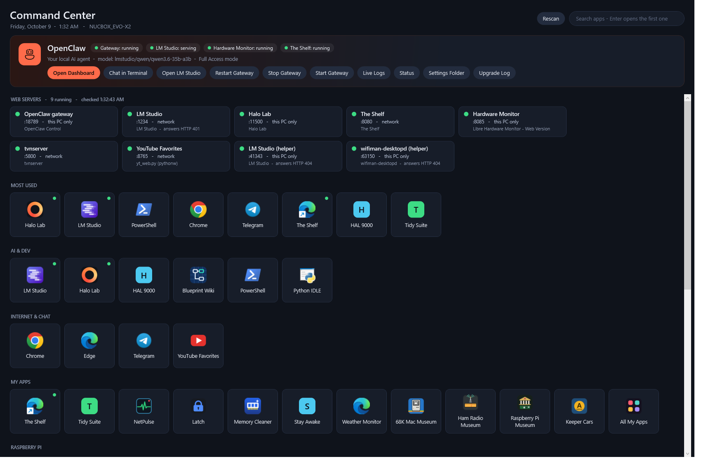

# Command Center

A Windows launcher for the apps you actually use, with a live **Web servers** board that shows
every local web server on your PC with a status light, a **Running / Stop** window that can stop
anything running on the PC, one-click controls for the
[OpenClaw](https://github.com/openclaw/openclaw) AI agent, and an **Update** button that gets the
newest version from this repo.



It's plain PowerShell and WPF. Nothing to install: it runs on the Windows PowerShell 5.1
that comes with Windows 10 and 11.

## What it shows

- **Web servers.** Every program listening on a TCP port that answers like a web page: its name
  (or the script behind it, such as `server.js (node)`), the port, the page title, and whether
  it's reachable from other devices (**network**) or only from **this PC**.
  - Green: running. Red: a known server that is not running. Amber: answering with an error.
  - Click a tile to open it. The red square on a running server stops it. Right-click to copy its
    link (or the link for phones and other PCs), force stop or restart it.
  - OpenClaw's gateway is stopped with `openclaw gateway stop`, and LM Studio with `lms server stop`
    (the LM Studio app stays open). Everything else is stopped with the program that owns the port.
  - Known servers are always listed so you can see when they are down: OpenClaw gateway (18789),
    LM Studio (1234), Halo Lab (11500 or the port set in Halo Lab), The Shelf (8080) and
    LibreHardwareMonitor (8085). Halo Lab's engine (11600), FastFlowLM (52625) and Ollama
    (11434) appear when they're running.
  - Servers that run through Windows' built-in web server (http.sys), like Halo Lab and
    LibreHardwareMonitor, are found too.
- **OpenClaw panel.** Status lights for the gateway, LM Studio, the hardware monitor and The
  Shelf, and buttons for the dashboard, chat, gateway start/stop/restart, live logs and status.
- **Most used.** Ranked by how often you open apps from Command Center *and* by Windows' own
  launch counter, so it reflects what you really use.
- **Your app groups** (AI & Dev, Internet & Chat, My Apps, Raspberry Pi, Games, System) and
  **Found on this PC**: apps the scanner found on the Desktop, the taskbar, the Start menu and
  in `Desktop\My Apps` that aren't in the list yet.
- **Running / Stop.** Everything running on the PC, grouped into servers (with their ports), apps
  with a window, and scripts and helpers, with live CPU and memory. Tick **Show everything** for
  background programs and Windows services.
  - **Stop / Close** asks apps with a window to close (so they can still ask you to save); servers
    and scripts are ended together with their helper processes, and a `.bat` window that only
    started that server closes too.
  - **...** has Force stop, stop every copy of a program, open in browser, show in Explorer, copy
    the command line.
  - **Stop all my servers...** stops every Python, Node, PowerShell, OpenClaw, Ollama and llama.cpp
    program and anything run from the Desktop or `My Apps`. You see the list first.
  - Windows' own core processes (and the taskbar) are never listed and can't be stopped. If a
    program needs administrator rights to stop, it offers to try again as administrator.
- **Right-click any app tile** to stop that app (or force stop it).
- **Update.** When Command Center starts it checks this repo once; the button turns orange and
  says **Update available** when GitHub has newer files. Clicking it shows what changes, downloads
  the files, checks each one arrived whole and that the PowerShell files have no errors, saves your
  current files in `backups\<date time>`, puts the new ones in place and restarts. Nothing changes
  unless every step works. Your settings in `%LOCALAPPDATA%\Command Center` are never touched, and
  each update is noted in `update-log.txt`.
- **Search.** Start typing to filter; Enter opens the first match. It searches web servers too.

## The scanner: `Scan-Apps.ps1`

Command Center runs it in the background (web servers every 20 seconds, apps twice a day, and
whenever you press **Rescan**). You can also run it on its own:

```powershell
powershell -ExecutionPolicy Bypass -File Scan-Apps.ps1
```

It prints your most used apps and every web server, and saves everything to
`%LOCALAPPDATA%\Command Center\scan.json`. It only reads; it never changes anything.

Where the data comes from:

| What | Source |
| --- | --- |
| Launch counts | Windows' UserAssist counter in the registry (times each program or shortcut was opened, and when) |
| Apps | Shortcuts on the Desktop, pinned to the taskbar and in the Start menu; app folders in `Desktop\My Apps` |
| Web servers | `Get-NetTCPConnection` for listening ports and their programs, then a quick HTTP request to each to read its status and page title |

## Install

1. Put the folder somewhere permanent (mine lives in `Desktop\My Apps\Apps\Command Center`).
2. Double-click **Start Command Center.bat**. It also puts a **Command Center** icon on the Desktop;
   use that from then on.

Only one window runs at a time: opening it again brings the existing window forward. If the
script was updated since that window opened, the old window closes and the new version starts.

To start it with Windows, copy the Desktop icon into the folder that **Win + R → `shell:startup`** opens.

## Files

| File | What it is |
| --- | --- |
| `Command Center.ps1` | The app. The app list near the top is easy to edit (name, group, what to open, icon, port for a status light). |
| `Scan-Apps.ps1` | The scanner described above. |
| `Running.ps1` | The Running / Stop window and everything that stops programs. |
| `Update.ps1` | The Update button (checks and downloads from this repo). |
| `Start Command Center.bat` | Starts it without a console window. |
| `Command Center.ico` | Icon. |

Settings and scan results are kept in `%LOCALAPPDATA%\Command Center`
(`usage.json`, `scan.json`, `startup-trace.txt`). To save a picture of the window for support,
create an empty file named `take-snapshot` in that folder; Command Center saves `snapshot.png` within 5 seconds.
